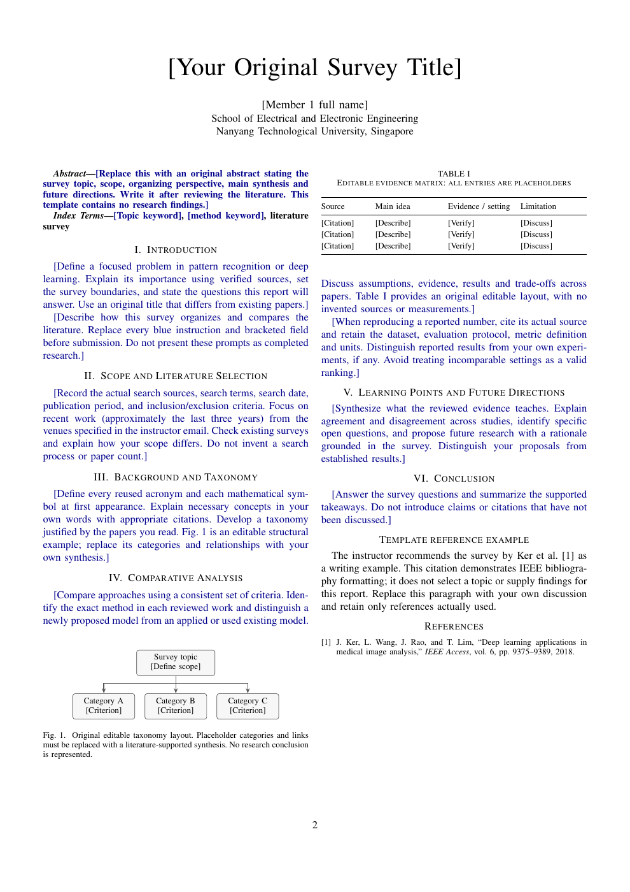

# EE6497 Survey Report Template

面向 NTU EE6497 *Pattern Recognition and Deep Learning* 的 LaTeX 综述报告模板。一个项目串起成员信息、独立首页、IEEE 双栏正文、原创图表和 Turnitin 附件；在 `config.tex` 填写一次姓名，即可同步到首页与正文作者栏。

模板基于 [IEEE 官方 Conference Template](https://www.overleaf.com/latex/templates/ieee-conference-template/grfzhhncsfqn)，按 2026 年课程作业要求及教师补充说明适配。课程要求见 [使用范围与提交要求](docs/course-requirements.md)；其他学期请结合当期通知使用。

[查看完整 PDF](docs/preview.pdf) · [课程要求](docs/course-requirements.md) · [主要文件](#主要文件)



## 开始写作

1. 点击 GitHub 的 **Use this template → Create a new repository** 建立自己的写作副本，再在新仓库选择 **Code → Download ZIP**。若直接在 Overleaf 写作，也可以从本仓库下载 ZIP。
2. 在 Overleaf 选择 **New project → Upload project**，上传 ZIP。将主文档设为 `main.tex`，编译器设为 **pdfLaTeX**，点击 **Recompile**。[Overleaf 导入说明](https://docs.overleaf.com/managing-projects-and-files/uploading-a-project)
3. 修改 [`config.tex`](config.tex)：设置实际人数（1–8）、报告标题、提交日期，以及各成员的姓名、贡献和签署日期。
4. 在 [`body.tex`](body.tex) 写摘要和正文，编辑图表源码，并在 [`references.bib`](references.bib) 维护实际引用的文献。

默认配置为 1 人，正文保留清晰的写作提示。提交前用自己的文献分析替换蓝色说明、方括号字段和图表中的示例项。

## 从首页到附件

| 部分 | 模板提供的结构 | 需要填写的内容 |
| --- | --- | --- |
| 独立首页 | 课程信息、规定的 Statement of Originality、成员表 | 姓名、实际贡献、日期、本人签名 |
| IEEE 正文 | 从物理第 2 页开始的 A4 双栏排版，含标题、摘要与章节 | 选题、文献综合、比较分析和结论 |
| 原创图表 | 可编辑 TikZ 分类图、无底纹比较表 | 基于所读文献形成的分类、关系与证据 |
| 参考文献 | IEEE 引用样式与真实文献格式示例 | 核验后的文献条目及正文引用 |
| Turnitin | 完整 PDF 自动追加开关 | 完成报告后的真实 Turnitin 文件 |

### 成员与签名

在 `config.tex` 修改 `\TeamSize`，并按字母顺序填写成员。姓名的拼写及顺序须与 matriculation card 一致；每位成员各自填写真实贡献、签署日期并签名。贡献栏保持简洁，编译后检查首页仍为一页。

成员本人提供的 PNG 签名可按行号命名为 `signatures/member-1.png` 至 `signatures/member-8.png`，模板会自动载入。也可以在完成的 PDF 上亲自签署。个人签名和 Turnitin 文件放在自己的本地或 Overleaf 写作副本中管理；仓库的 `.gitignore` 已默认忽略这两个附件目录中的个人文件。

首页保留课程要求的原句：

> I hereby certify that the work embodied in this report is the result of original research and is free of plagiarised materials.

### 正文、图表与引用

正文按「问题与范围 → 文献选择 → 背景与分类 → 比较分析 → 学习要点与未来方向 → 结论」组织。章节可随选题调整，让分类和比较服务于综述的核心问题。

- [`figures/original-taxonomy.tex`](figures/original-taxonomy.tex)：直接编辑节点文字和连接关系，形成自己的文献分类图。
- [`tables/original-comparison.tex`](tables/original-comparison.tex)：按一致标准填写方法、证据与局限，形成可比较的文献矩阵。
- [`references.bib`](references.bib)：内含教师推荐的 Ker et al. (2018) 文章，用于展示参考文献格式；写作时保留实际引用项并补充已核验文献。

至少保留一张原创图和一张原创表，并在正文中引用。图表的示例项用于展示布局，填写时以实际文献为依据。按每位成员至少 **2 整页 IEEE 双栏内容**规划篇幅，具体计数说明见[课程要求](docs/course-requirements.md#篇幅与排版)。

### 追加 Turnitin

完成并检查报告后，将真实 Turnitin 报告上传为 `attachments/turnitin-report.pdf`，再将 `config.tex` 中的开关改为：

```tex
\AttachTurnitintrue
```

重新编译后，完整附件会接在参考文献之后，附加说明页自动移除。若无法通过 LaTeX 合并，可先导出报告，再用 PDF 合并工具追加 Turnitin，保持「签署首页 → 正文与参考文献 → Turnitin」的顺序。教师允许的截图备用方式见[课程要求](docs/course-requirements.md#turnitin-与提交)。

## 主要文件

| 文件 | 用途 |
| --- | --- |
| [`main.tex`](main.tex) | 主文档、IEEE 排版与附件流程 |
| [`config.tex`](config.tex) | 标题、1–8 人成员信息和 Turnitin 开关 |
| [`cover.tex`](cover.tex) | 首页声明、贡献和签名栏 |
| [`body.tex`](body.tex) | 摘要与综述正文 |
| [`figures/original-taxonomy.tex`](figures/original-taxonomy.tex) | 可编辑分类图 |
| [`tables/original-comparison.tex`](tables/original-comparison.tex) | 可编辑比较表 |
| [`references.bib`](references.bib) | BibTeX 文献库 |
| [`turnitin-placeholder.tex`](turnitin-placeholder.tex) | 未开启附件时显示的操作说明 |
| [`docs/preview.pdf`](docs/preview.pdf) | 默认配置的排版预览 |

## 本地编译

安装包含 pdfLaTeX 与 `latexmk` 的 TeX 发行版，在项目根目录运行：

```sh
latexmk -pdf main.tex
```

生成文件为 `main.pdf`。清理编译中间文件并保留 PDF：

```sh
latexmk -c
```

默认配置及 8 人首页已完成编译和排版检查；填写较长标题、姓名或贡献后，再检查分页与表格高度。

## 模板来源

这是依据课程要求制作的社区模板。IEEE 排版来自 [IEEE Conference Template](https://www.overleaf.com/latex/templates/ieee-conference-template/grfzhhncsfqn)，`IEEEtran.cls` 和 `IEEEtran.bst` 来自 [CTAN IEEEtran](https://ctan.org/pkg/ieeetran)，保留原文件的版权和许可说明。独立首页、成员配置、图表示例及 Turnitin 附加流程为本项目的课程适配部分。

本项目新增代码与文档采用 [MIT License](LICENSE)，方便复用和修改。IEEEtran 文件继续遵循原 LPPL 许可；归属与引用范围见 [第三方说明](THIRD_PARTY_NOTICES.md)。
